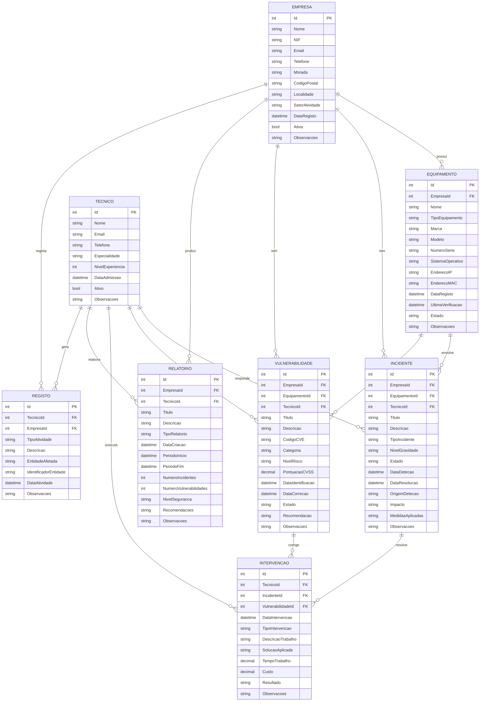

# 02 - Diagrama Entidade-Relação

## Cardinalidades

- Empresa 1:N Equipamento
- Empresa 1:N Incidente
- Empresa 1:N Vulnerabilidade
- Empresa 1:N RelatorioSeguranca
- Empresa 1:N RegistoAtividade
- Equipamento 1:N Incidente
- Equipamento 1:N Vulnerabilidade
- Tecnico 1:N Incidente
- Tecnico 1:N Vulnerabilidade
- Tecnico 1:N Intervencao
- Tecnico 1:N RelatorioSeguranca
- Tecnico 1:N RegistoAtividade
- Incidente 1:N Intervencao
- Vulnerabilidade 1:N Intervencao
